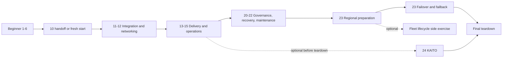

# Enterprise AKS refresher - 2026

Operate one evolving AKS platform: establish private access, integrate Azure services,
deliver through Git, diagnose failures, scale within bounds, and recover durable state.
There are **22 numbered labs**, plus optional focused workshops. Difficulty, prerequisites,
and deployment boundary are separate choices; optional exercises are not a second mandatory track.

## Choose your path

| Starting point | Path |
|---|---|
| New to AKS operations | [1](labs/01-aks-readiness.md) through [6](labs/06-troubleshooting-and-lifecycle.md), then [10's beginner handoff](labs/10-baseline.md#entry-paths). Do not redeploy or rerender. |
| Experienced operator | [10 fresh start](labs/10-baseline.md#entry-paths), then 11-15 and 20-23 in order. |
| Returning to a progressed environment | Use the [state map](docs/state.md), reconnect, verify the last checkpoint and resume the unfinished part. Never reset to bootstrap to fix missing evidence. |
| No Azure budget or waiting for approval | [27 Kustomize](labs/27-kustomize.md), [incident tickets](workshops/incident-response.md), or the explicitly design-only parts of a lab. These do not certify live Azure behavior. |

**Before provisioning:** approve the [complete billable inventory](docs/operations.md#before-spending-anything)
and [later prerequisites](docs/operations.md#early-go-no-go-decisions). Beginners deploy the
same six-node enterprise foundation, with Firewall, Bastion, Premium dependencies and a private
build VM; this is not a low-cost starter cluster. Budget alerts are not spending caps.

The required cumulative path retains its order. Numbers **7-9 and 16-19 remain unused**.
Workshops deepen a capability without changing that numbering or becoming hidden prerequisites.

## Lab index

### Foundations and operator readiness

| Lab | Difficulty | Unique outcome |
|---|---|---|
| [1. AKS readiness](labs/01-aks-readiness.md) | Beginner | Approve responsibilities, permissions, address plan, regional capacity and full cost. |
| [2. Safe provisioning](labs/02-provision-aks.md) | Beginner | Review what-if, apply once and match Azure resources to the design. |
| [3. Access and identity](labs/03-access-and-identity.md) | Beginner | Separate human connectivity, authentication and authorization. |
| [4. Node pools and capacity](labs/04-node-pools-and-capacity.md) | Beginner | Explain placement, requested capacity, zones, surge and storage ownership. |
| [5. ACR and workloads](labs/05-acr-and-workloads.md) | Beginner | Prove publishing, pulling, rollout and process health separately. |
| [6. Troubleshooting and lifecycle](labs/06-troubleshooting-and-lifecycle.md) | Beginner | Recover a bounded scheduling fault and hand off an unchanged foundation. |
| [10. Enterprise baseline](labs/10-baseline.md) | Intermediate entry | Establish the same platform fresh, or review beginner evidence without repetition. |

### Secure connectivity and integration

| Lab | Difficulty | Unique outcome |
|---|---|---|
| [11. Identity and integration](labs/11-identity.md) | Intermediate | Workload federation, component-scoped data rights and live CSI rotation. |
| [12. Private networking and publishing](labs/12-networking.md) | Intermediate | Private dependencies/egress, then internal ingress/TLS and policy enforcement. |

### Delivery and day-two operations

| Lab | Difficulty | Unique outcome |
|---|---|---|
| [13. GitOps delivery](labs/13-gitops.md) | Intermediate | Private publishing, one-time adoption, reviewed digest promotion and release recovery. |
| [14. Observability](labs/14-observability.md) | Intermediate | Instrument, correlate and diagnose user impact; prove alert delivery. |
| [15. Scaling and cost](labs/15-scaling.md) | Intermediate | Separate pod scaling from node capacity; measure bounds, correctness and cost. |

### Governance, recovery and maintenance

| Lab | Difficulty | Unique outcome |
|---|---|---|
| [20. Multi-team governance](labs/20-governance.md) | Advanced | Attribute RBAC, PSA, quota and policy denials; govern exceptions. |
| [21. Data and recovery](labs/21-data-recovery.md) | Advanced | Durable orders, CSI data restore and independent database PITR. |
| [22. Lifecycle management](labs/22-upgrades.md) | Advanced | Compatibility gates, real eviction, supported upgrades and measured business effect. |
| [23. Multi-region capstone](labs/23-multi-region.md) | Advanced | Prepare regional recovery, fence writers, fail over, fail back and re-protect. |

Labs 12-15, 21 and 23 contain resumable parts. Follow their checkpoint tables rather than
trying to complete every task in one sitting. Lab 23's Fleet exercise is a separate optional
lifecycle activity once the second platform exists, not a DR promotion prerequisite.

### Offline skills and optional specialists

| Lab | Choose it for | Boundary and prerequisites |
|---|---|---|
| [27. Progressive Kustomize](labs/27-kustomize.md) | Manifest composition, not release delivery | Offline; easy tier before 11, medium before 13, hard tier whenever useful. No Azure bill. |
| [24. KAITO inference](labs/24-kaito.md) | GPU/operator/model lifecycle | Cumulative extension after 15; healthy private GitOps platform and separate GPU approval. Complete before teardown. |
| [25. RabbitMQ storage density](labs/25-rabbitmq-container-storage.md) | Volume/attachment density and quorum failure domains | Independent dedicated cluster; storage SKU/quota and its own private management prerequisites. |
| [26. Confidential placement](labs/26-confidential-compute.md) | Hardware trust boundaries and capacity placement | Independent cluster; confidential SKU/quota and its own private management prerequisites. |
| [28. Overlay overlap incident](labs/28-overlay-overlap.md) | Pod/data-plane addressing failure | Fully isolated disposable networks, cluster and VMs. Never peer with cumulative or corporate networks. |
| [29. API private connectivity](labs/29-api-private-connectivity.md) | Control-plane public-to-private cutover | Separate VNet-integrated cluster and unpeered consumer endpoint. Never alter the cumulative API. |

### Focused workshops

| Workshop | When | Completion boundary |
|---|---|---|
| [Workload reliability and safe releases](workshops/workload-reliability.md) | After 5 or 13 | Isolated incident namespace: probes, bounded memory failure, termination and rolling updates. |
| [API authentication and authorization](workshops/api-authentication.md) | After 13 | Offline signed-token tests, then optional Entra integration in `orders-test`; primary defaults unchanged. |
| [Incident-response practicum](workshops/incident-response.md) | After 14 | Offline symptom-first synthetic evidence, diagnosis, repair plan and acceptance rubric. |
| [Infrastructure lifecycle](workshops/infrastructure-lifecycle.md) | After 22 | Read-only inventory and offline desired-state/replacement rehearsal; no bootstrap replay. |
| [Artifact trust](workshops/artifact-trust.md) | After 13 and 20 | Local signature/assessment/admission decision exercise; not a silently installed admission controller. |

Certificate renewal is an extension in 12, private-observability design in 14, and measured
rightsizing/cost in 15. These extend the existing capability rather than add competing stacks.

## How to use the curriculum

Read the visible **Lab contract**, challenge, evidence and stop conditions before opening
the collapsed **Solution**. A hidden block is not an optional setup step. Use GitHub's
rendered Markdown view. Each contract separates estimated active time from provider waiting
time; these are planning estimates, not measured completion promises.

**Teach once, apply repeatedly:** human identity belongs to 3, workload federation to 11,
and team delegation to 20. Lab 14 uses CPU pressure to diagnose; 15 uses it to observe scaling.
Lab 15 demonstrates memory-only deduplication's failure; 21 repeats the
[same experiment contract](docs/operations.md#duplicate-and-restart-evidence) with durable storage.

Use the [operations handbook](docs/operations.md) for setup, sessions, trust, review and teardown,
and the [state/ownership map](docs/state.md) to know what each stage retains. Stable procedures
live there; local safety gates and task-specific recovery remain beside the lab commands.

## Scope and readiness

These are lab materials, **not a certified production landing zone**. Native Bastion AKS
tunneling has an explicit `aks-preview` dependency. Live availability, Azure charges and
end-to-end recovery are not certified for your subscription; use the
[reviewed tooling/support baseline](docs/operations.md#tooling-and-support) and runtime gates.

The cumulative sample is unauthenticated by default and uses synthetic data only. The optional
authentication workshop does not silently secure existing primary deployments. The API starts
private, but dependency endpoints become private only in lab 12. Lab 14 deliberately uses
approved authenticated public telemetry; private AKS does not imply private-only monitoring.

## Reference and contribution

| Need | Start here |
|---|---|
| Setup and permissions | [Bootstrap configuration](docs/operations.md#bootstrap-configuration), [private build VM](docs/operations.md#private-build-vm) |
| Resume or change hosts | [Session procedures](docs/operations.md#bastion-sessions-and-data-plane-access), [state map](docs/state.md) |
| Pause or end the course | [Ordered cleanup](docs/operations.md#pausing-resuming-and-final-cleanup); complete optional 24 first if chosen |
| Existing learner | [Numbering history](docs/operations.md#existing-learner-migration); no resource or state migration |
| Improve the material | [Contributor guide](CONTRIBUTING.md), offline PR checks and [repository ownership](docs/operations.md#repository-layout-and-ownership) |
