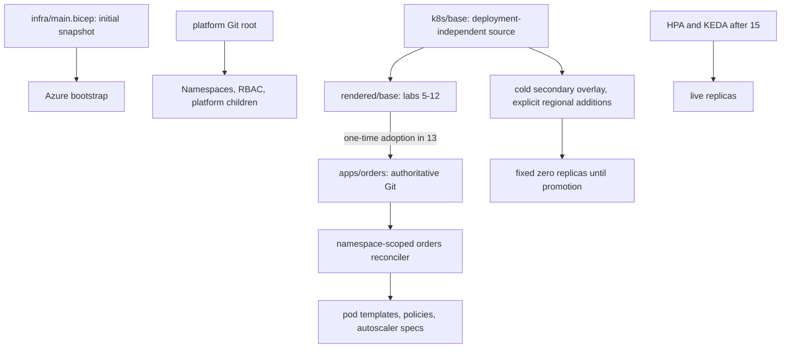

# State, ownership and re-entry

The cumulative labs are a sequence of **state transitions**, not independent deployment recipes.
This map records the expected boundary after each stage. It is not an automatic stage detector:
a different live value is a reason to investigate, never permission to reset the environment.
Use the [handbook](operations.md) for sessions and the current lab for exact recovery commands.

## Stage map

| Completed stage | Retained state / authoritative source | Owner | Read-only re-entry evidence |
|---|---|---|---|
| 1 | Ignored `local.settings.json`, two separate SSH key pairs; approved dedicated RG | Bootstrap operator | Approved tenant/subscription, settings, quota/version/cost worksheet; no cluster claimed. |
| 2 | `foundation` deployment, private AKS, six nodes, Bastion/build VM/firewall, Premium dependencies | Azure platform operator | Deployment Succeeded; actual pools/network/identity and VM readiness. |
| 3-4 | Same foundation plus a temporary current-shell API session | Human operator; Bastion only owns connectivity | Verified CA/private TLS name, intended context, successful Entra request and node inventory. |
| 5-6 / 10 | Image plus accumulated `rendered/base`; API two replicas, worker one | Operator applies rendered manifests | Lab 6 handoff checks, completed rollout, probes; no residual selector fault. |
| 11 | CSI mount/provider and workload federation; `rendered/base` gains identity files | Operator; separate API/worker identities | Correct federation subjects, mounted `version-two`, recovered processing; worker vault denial. |
| 12 | Private endpoints/DNS, UDR, policies, private Gateway/TLS; rendered base retained | Platform: Azure/Gateway/TLS; operator: app rendered source | Ordinary trusted HTTPS, private dependency access, healthy nodes and no hostAliases fault. |
| 13 | One-time copy into `gitops/clusters/primary/apps/orders` and `orders-test`; read-only runtime Git credential | Platform Flux root owns namespaces/RBAC; app child owns only allowed namespace resources | Correct remote, children Ready at reviewed SHA, immutable images, primary CSI still works. |
| 14 | Telemetry patch/PodMonitor in app Git; destinations/diagnostics and telemetry Secret outside app Git | App reconciler plus platform monitoring owner | Scrape/correlation/alert evidence, no probe/queue override, no suspended child. |
| 15 | HPA/KEDA in app Git; **Deployment replicas omitted**; apps CA bounds retained | Flux: specifications; HPA: API replicas; KEDA: worker activation/HPA; CA: nodes | Healthy ScaledObject; no pause/delay/Spot fault; active queue drained, dead-letter baseline retained. |
| 20 | Team namespaces/PSA/quota/policy and Defender | Platform `teams` child and Azure governance owner | Attributed denials, policy sync and exact coverage; no incident probes/waiver. |
| 21 | Primary PostgreSQL with durable orders; DB patch/private-IP policy in app Git; storage and backup | App SQL roles, platform `storage`, backup/database owners | Durable ID/item/SQL count, restored hash, completed jobs; original primary repopulated after PITR. |
| 22 | Updated AKS/pool versions/images, maintenance settings, tested PSA minor | One approved lifecycle owner | Supported target/current versions, no cordon or maintenance probes, healthy business and Flux. |
| 23 preparation | Secondary platform, regional endpoints/replication, cold app zero, **no secondary HPA/KEDA** | Regional platform/app owners | Local private paths, matching digest, replica mode/known row, zero writers in secondary. |
| 23 failover | Primary live + Git fence, promoted secondary DB/bus, secondary active | Incident/data authority | Both writer/traffic gates passed, accepted-ID ledger and one row per ID; primary stays fenced. |
| 23 failback | Active database is the **return server**, not original `$Pg`; primary autoscalers restored | Data owner and normal app/scaling owners | Entire ledger including secondary-created order, correct endpoint/PE IP, reprotection or explicit decommission decision. |

`foundation` outputs identify bootstrap resources; they do **not** prove current desired versions,
networking or the authoritative post-failback database. Save the return-server ID/FQDN and its
reviewed endpoint change in the operational inventory.

## Source and responsibility boundaries



| Surface | Normal source | Never use as a shortcut |
|---|---|---|
| Initial platform | `infra/main.bicep` plus reviewed local inputs, first deployment only | Redeploying bootstrap over later add-ons, subnets, outbound type or versions. |
| Progressed platform | Focused Azure changes, their evidence, and an explicitly owned consolidation plan | Treating deployment history deletion as resource deletion or an ARM export as deployable intent. |
| Primary app before 13 | Accumulated ignored rendered directory | Rerendering after adding CSI/network policy. |
| Primary app from 13 | Reviewed application Git path | Applying the original base or recopying rendered state. |
| Gateway/certificates | Lab-12 platform manifest and protected local key material | Granting namespace Flux permission to deploy arbitrary cross-namespace resources or committing PEM keys. |
| Replica counts from 15 | HPA/KEDA; Git owns their bounds | Git `replicas` transformers, permanent scale patches, or a second HPA. |
| Cold secondary | Explicit regional overlay derived from stable base | Copying primary HPA/KEDA/scaler identities or assuming CSI/telemetry automatically followed. |
| Customer authentication | Optional workshop's test-only configuration | Assuming Workload ID authenticates callers or that the primary was secured automatically. |

## Re-entry checklist

Read the last recorded lab/part and all unresolved recovery notes first. The following commands
are **read-only**, except starting a local tunnel when needed; they do not repair state.

```bash
source ./scripts/use-lab.sh
az account show --query '{subscription:id,tenant:tenantId}' -o json
az aks show -g "$(lab_value ResourceGroup)" -n "$(lab_value ClusterName)" \
  --query '{id:id,state:provisioningState,version:kubernetesVersion,outbound:networkProfile.outboundType}' -o json
```

If no tunnel is active, activate it using the handbook; do not start a duplicate session or
overwrite its kubeconfig. Then verify lab 3's TLS/context checks and inspect:

```bash
kubectl config current-context
kubectl --request-timeout=30s get nodes
kubectl -n orders get deployments,pods
git status --short
```

Only once lab 13 exists:

```bash
flux get kustomizations -A
flux get sources git -A
```

Only once lab 15 exists:

```bash
kubectl -n orders get hpa,scaledobject,triggerauthentication
az aks nodepool list -g "$(lab_value ResourceGroup)" --cluster-name "$(lab_value ClusterName)" \
  --query '[].{pool:name,count:count,min:minCount,max:maxCount,autoscaling:enableAutoScaling}' -o table
```

Zero workers can be healthy with an empty queue; do not impose the beginner replica check on
an autoscaled environment. Restore CA-bundle exports before ordinary HTTPS. Do not interpret a
missing CRD, permission denial, or unavailable evidence file as proof the related stage never ran.
Stop and identify the current owner. Lab 23 re-entry needs **both fresh regional tunnel paths**
and the accepted ledger/authoritative database inventory; do not infer these from primary settings.

## What to retain at a checkpoint

Record the exact source/reconciler revision and resource identities, verification time, ephemeral
fault state (must normally be none), remaining billable resources and next task. Keep private
generated files out of Git; losing the build host must not lose the only recovery evidence.
Use an approved private evidence location outside the resources scheduled for deletion.

After 12, retain certificate/trust files and the private gateway source. After 13, retain the
reviewed Git repository and runtime credential rotation record. After 21, retain recovery-point
identities, hashes and known orders. After 23, retain the accepted ID/item ledger and new database
inventory. No checkpoint permits collecting raw credentials.

## Independent and optional boundaries

Lab 24 extends a healthy post-15 primary and must remove its GPU capacity before final teardown.
Labs 25/26 require their own cluster access and resource lifecycle. Lab 27 is entirely local.
Lab 28's overlap network is **never** a peer of this cumulative platform. Lab 29 changes only
its dedicated API architecture. The reliability workshop uses its own namespace; the auth
workshop changes only `orders-test`; incident and infrastructure offline exercises do not mutate
the cluster. Complete each exercise's cleanup before returning to the cumulative path.

**Return:** [Lab index](../README.md#lab-index).
